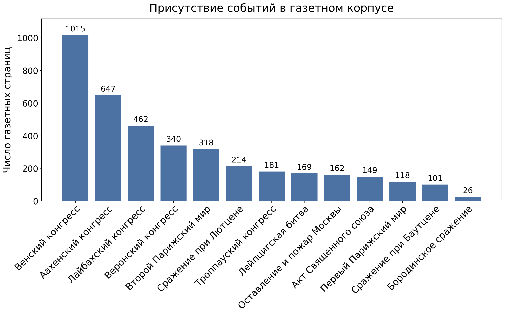
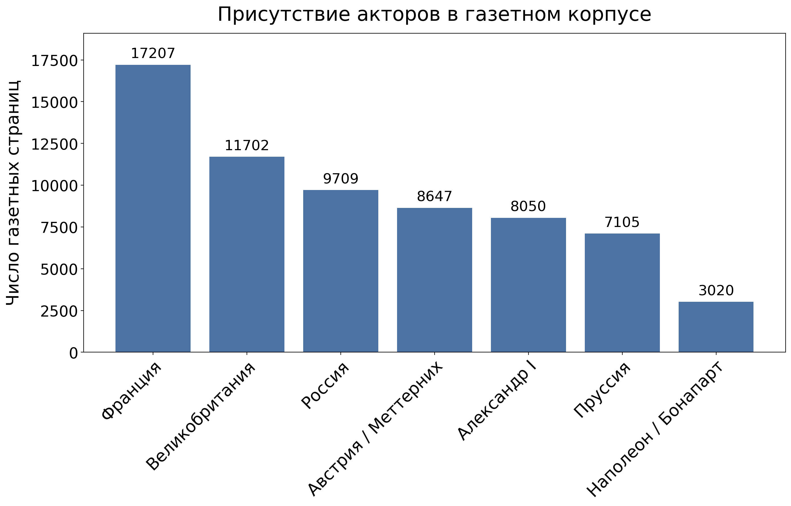

# Обработка двух корпусов Gallica для статьи

Самостоятельный проект с кодом контент-анализа, проверки устойчивости, сопоставления двух корпусов, анализа состава газет и формирования таблиц, графиков и чернового Word-отчета.

Парсер и скачивание вынесены в отдельный проект `Gallica_corpus_parser_project`. Этот проект не обращается к Gallica и не скачивает страницы: он читает уже созданные SQLite-базы и OCR-файлы.

## 1. Исходные данные

Для воспроизведения нужны:

1. `state_events_alexander_policy_1812_1822.sqlite3` — база первоначального событийного поиска;
2. `state_all_newspapers_1812_1825.sqlite3` — база персонализированного поиска по Александру I и Священному союзу;
3. отдельная папка `Journal_de_la_Loz_re`, если эта газета была скачана отдельным проходом;
4. `data/newspaper_type_audit.csv` — классификация публикаций, оставляющая только газеты.

Многогигабайтные базы, JPG, ALTO и OCR в проект не включены. Их создает `Gallica_corpus_parser_project`, а пути задаются в `configs/analysis.json`.

## 2. Структура

```text
Gallica_article_analysis_project/
├── analysis/                    аналитические скрипты
├── configs/analysis.example.json
├── data/newspaper_type_audit.csv
├── outputs/                     результаты воспроизводимого расчета
├── requirements-analysis.txt
└── README.md
```

## 3. Установка

```powershell
Set-Location "<project-directory>/Gallica_article_analysis_project"
python -m venv .venv
.\.venv\Scripts\Activate.ps1
python -m pip install --upgrade pip
python -m pip install -r requirements-analysis.txt
```

Требуется Python 3.11 или новее.

## 4. Настройка путей

```powershell
Copy-Item configs/analysis.example.json configs/analysis.json
```

Если оба проекта находятся рядом, пример уже указывает на `../Gallica_corpus_parser_project/data`. Если реальные корпуса лежат в другом месте, измените `parser_root` на абсолютный путь.

```json
{
  "parser_root": "<corpus-data-directory>",
  "event_database": "state_events_alexander_policy_1812_1822.sqlite3",
  "personalized_database": "state_all_newspapers_1812_1825.sqlite3",
  "extra_personalized_corpus": "corpus_alexandre_sainte_alliance_1812_1825/Journal_de_la_Loz_re",
  "newspaper_type_audit": "../data/newspaper_type_audit.csv",
  "output_root": "../outputs/reproduction"
}
```

Относительные пути к базам и дополнительному корпусу разрешаются от `parser_root`. Путь к аудиту и выходной папке разрешается от каталога конфигурации.

## 5. Полный запуск

```powershell
python analysis/run_analysis.py --config configs/analysis.json
```

Без Word-черновика:

```powershell
python analysis/run_analysis.py --config configs/analysis.json --skip-report
```

Конвейер последовательно запускает основной анализ, проверки устойчивости, анализ состава, сводку состава, переклассификацию газет, сравнение корпусов и создание отчета.

## 6. Что делает каждый скрипт

### `event_content_analysis.py`

- объединяет событийную и персонализированную базы;
- добавляет отдельно скачанный `Journal de la Lozère`;
- исключает журналы и прочие публикации;
- удаляет межкорпусные дубли по `ARK + page`;
- нормализует регистр, апострофы, лигатуры и диакритику;
- делит текст на окна 50, 100, 150 и 200 слов с перекрытием 20%;
- кодирует 13 событий, 7 акторов и 9 смысловых категорий;
- считает направленные доли `событие → актор` и `актор → событие`;
- создает CSV, PNG и манифест исследования.

Основное аналитическое окно — 100 слов. Последний фрагмент короче 30 слов отбрасывается.

### `reviewer_robustness_analysis.py`

- сравнивает окна с перекрытием и без него;
- проверяет результат без пяти крупнейших газет;
- рассчитывает интервалы Уилсона;
- сравнивает широкие и узкие словари `ordre`, `droit`, `intervention`;
- оценивает повторные OCR-тексты по SHA-256.

### `composition_analysis.py` и `composition_summary.py`

- анализируют состав корпуса по годам и газетам;
- используют политическую классификацию: либеральные, умеренные, консервативные;
- используют географическую классификацию: столичные, провинциальные, колониальные;
- сравнивают обычное среднее с макросредним, где газеты имеют равный вес;
- рассчитывают присутствие Александра I в контекстах Акта и конгрессов.

### `reclassify_article_press.py`

Формирует CSV и JSON с трехчастной политической и географической классификацией. Изменение Word-файла выполняется только при явно заданной переменной `GALLICA_ARTICLE_DOCX`.

### `corpus_comparison_stats.py`

Считает размеры событийного и персонализированного корпусов, их пересечение по `ARK + page`, уникальные страницы каждого корпуса и объем объединения.

### Вспомогательные скрипты

- `audit_personalized_corpus_stats.py` — статистика страниц, выпусков, газет, слов и отсутствующих OCR;
- `build_event_content_report.py` — черновой Word-документ с таблицами и интерпретацией;
- `run_analysis.py` — единая точка запуска всего конвейера.

## 7. Основные результаты

После запуска файлы появляются в `outputs/reproduction/`:

- `combined/` — основной контент-анализ и графики;
- `composition/` — состав газет по годам, ориентации и географии;
- `composition_summary/` — агрегированные таблицы состава;
- `reclassification/` — итоговая классификация изданий;
- JSON/CSV сравнения корпусов и Word-черновик.

Точные названия главных файлов в `combined/` начинаются с порядковых номеров `00_`–`09_`: манифест, аудит изданий, отсутствующий OCR, коды событий по страницам, состав корпуса, частоты событий, совместная встречаемость, проверка окон и кодировочная схема.

### Графики, включенные в статью



*Рисунок 1. Число уникальных газетных страниц, на которых обнаружено упоминание соответствующего события. Если название события несколько раз встречалось на одной странице, страница учитывалась один раз. График построен по объединению персонализированного и событийного корпусов. Источник: построено автором по результатам анализа корпуса Gallica.*

Наибольшие событийные подкорпусы образовали Венский (1 015 страниц), Аахенский (647), Лайбахский (462) и Веронский (340) конгрессы. Таким образом, после объединения двух поисковых выборок основной объем материала сосредоточился не только вокруг военных событий 1812–1813 гг., но и вокруг послевоенной конгрессной системы. Вместе с тем высота столбца характеризует объем обнаруженного подкорпуса, а не непосредственно историческую значимость события или интенсивность его оценки: на показатель влияют календарные границы, словарь индикаторов, сохранность OCR и состав доступных газет.



*Рисунок 2. Число уникальных газетных страниц объединенного корпуса 1812–1825 гг., на которых обнаружен соответствующий актор. Если актор упоминался на одной странице несколько раз, страница учитывалась один раз. Австрия и канцлер К. фон Меттерних образуют одну составную категорию. Источник: построено автором по результатам анализа корпуса Gallica.*

Первое место Франции (17 207 страниц) закономерно для корпуса французской печати и отражает постоянное присутствие внутреннего национального контекста. Далее следуют Великобритания (11 702), Россия (9 709), составная категория «Австрия / Меттерних» (8 647) и Александр I (8 050). Высокая позиция российского императора подтверждает выраженную персонализацию международной повестки, но не позволяет сама по себе признать его главным актором всей конгрессной системы. Для этого в исследовании отдельно сопоставляются конкретные события и 100-словные окна: агрегированная частота показывает общую видимость, тогда как различия между Троппау, Лайбахом и Вероной устанавливаются по контекстной совместной встречаемости. Сумма столбцов превышает число страниц корпуса, поскольку несколько акторов могут присутствовать на одной странице и категории не образуют взаимоисключающего распределения.

## 8. Методические ограничения

- совместная встречаемость в окне показывает близость индикаторов, но сама по себе не доказывает поддержку, критику или причинную связь;
- корпус сформирован поисковыми запросами, а не случайной выборкой всей французской прессы;
- качество отбора зависит от OCR Gallica;
- широкие основы вроде `ordre`, `droit` и `intervention` неоднозначны, поэтому предусмотрена проверка узких словарей;
- повторные публикации в разных выпусках сохраняются как самостоятельные факты циркуляции текста;
- цитаты и спорные контексты необходимо сверять со сканами.

## 9. Техническая проверка

```powershell
python -m py_compile analysis/*.py
python analysis/run_analysis.py --help
```

